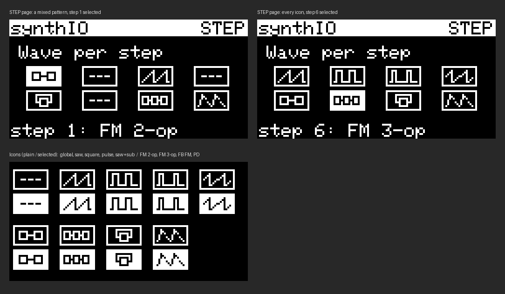

# picostepseq synth: plan for the next firmware rewrite

Status: **built** (sections 1-6). Section 7 ("Later") is still open.
Not yet verified with the real Arduino toolchain / hardware at the time of writing.

Implementation notes that differ from or add to the plan:
- WAVE page edits the **global** model (same as SYNTH "Wve"). To tweak the controls of a model that is only
  used on some steps, temporarily set it as the global wave.
- MIDI page "Out" has 4 values: MIDI, CLK 4, CLK 24, TRIG. The MIDI page has 5 rows.
- DELAY page bottom line shows the actual delay time in ms at the current tempo (`!` = clamped to 1.5 s).

## 1. Sound engine: four new models (own code, not ported)

Added to the wave list after the classic waves:

| # | Model | Control A | Control B | Character |
|---|---|---|---|---|
| 0 | saw | – | – | classic |
| 1 | square | – | – | classic |
| 2 | pulse | – | – | classic |
| 3 | saw+sub | – | – | classic |
| 4 | **FM 2-op** | Ratio | Index | bells, e-piano, DX bass, brass |
| 5 | **FM 3-op** | Ratio | Index | metallic, complex, brutal |
| 6 | **FB FM** | Feedback | Index | clean, then saw-like, then gritty, then noise |
| 7 | **PD** (phase distortion) | Shape | Amount | CZ-style bent saw, then resonant sweep |

- Tune all four a bit **darker and more aggressive** than the prototype demos.
- **Ratio is always in tune**, snapping to 0.5, 1, 1.5, 2, 3, 3.5, 4, 5, 7.
- **Pluck:** the FM index (and PD amount) follows the envelope. How much it follows is set by the **Env** bar on the SYNTH page.
- Same signal path as now: model, drive, filter, amp envelope, bitcrush.
- Integer/fixed-point implementation (sine table + phase accumulators). The prototype is in float on the desktop.
- FM oscillators need a lower output level than the classic waves (the prototype clipped at the same level).

## 2. Pages

SHIFT = hold step key 1, then tap the page key. **SHIFT + the same key again, or SHIFT + key 8, leaves any page.**
On every page the sequencer keeps running, push + turn still changes BPM, and step keys keep working
(except on the STEP page, see below).

| Page | Combo | Content |
|---|---|---|
| 1. **SYNTH** | SHIFT + 2 | As now (wave text + bars for Grt/Cut/Res/Atk/Dcy/Env). **Wve row adds the wave icon at the right end of the row**, changing as you scroll waves. |
| 2. **WAVE** (new) | SHIFT + 3 | Current model name + icon, and the model's 2 controls as bars. **Bar labels change per model** (Ratio/Index, Feedback/Index, Shape/Amount). Classic waves have no controls (show "no controls" or hide the bars). |
| 3. **STEP** (new) | SHIFT + 4 | 8 boxes (one per step) showing each step's wave icon. Selected box filled white, icon inverted. Bottom line: `step 6: FM 3-op`. |
| 4. **DELAY** (new) | SHIFT + 5 | Stereo ping-pong delay, 5 controls (see section 5). |
| 5. **MIDI** | SHIFT + 6 | As now, plus **Out: MIDI / CLOCK / TRIG** (see section 4). |
| 6. **LOAD/SAVE** (merged) | SHIFT + 7 | Replaces the separate LOAD and SAVE pages. 8 slot boxes, selected filled white. **Turn** = pick slot, **tap** encoder = load, **hold encoder 1s** = save. Bottom line hint `tap:load hold:save`, then `loaded seq 3` / `saved to seq 3`. |

Common page controls: turn = change selected value (or pick slot/step), tap encoder = next item.

STEP page controls:
- **Tap a step key** selects that step's box. On this page only, keys select instead of muting.
- **Turn the encoder** changes the selected step's wave.
- **Tap the encoder** moves to the next step.

Page layout style: built-in 6x8 font, inverted title bar `synthIO ... <PAGE>`, select arrow + 3px label shift
for list items, filled box for selected slot/step.

## 3. Per-step waves

- Each step stores a wave: one of the 8 models, or **global** (`- - -`), which follows the wave on the SYNTH page.
- Only the model is per step. Steps using the same model share its two WAVE-page settings.
- Saved with the sequences in `saved_sequences.json` (an extra value per step). Old files load with all steps = global.
- The wave switches at the note start (each step retriggers the note), so there are no clicks.

## 4. Clock / trigger out on the MIDI OUT DIN (GP16)

- MIDI page setting **Out**:
  - **MIDI**: normal serial MIDI out (as now).
  - **CLOCK**: pulses at 4 or 24 ppqn (to match Mutable Instruments Grids' clock setting), **only while playing**.
  - **TRIG**: one pulse per **active (unmuted) step**.
- In CLOCK/TRIG mode the UART is detached from GP16, and GP16 is driven directly: idle low, ~5 ms high pulses.
- DIN MIDI out is disabled in those modes; **USB MIDI keeps working**.
- No reset output.
- Cable (DIN to mono 3.5mm): **DIN pin 5 to tip**, **DIN pin 2 to sleeve**, **DIN pin 4 unconnected**
  (it carries 3.3V through 33 Ω). 3.3V pulses should trigger most Eurorack clock inputs.

## 5. Stereo delay (DELAY page)

Output becomes **stereo**: the dry synth stays in the centre, and the delay echoes **ping-pong** left/right.
Both DAC channels are free for audio, since clock/trig goes out over the DIN.

Controls (page layout in the style of page 1):

| Label | Control | Type | Notes |
|---|---|---|---|
| Tim | **Time** | text | tempo-synced: 1/16, 1/8T, 1/8, 1/8 dotted, 1/4T, 1/4. Follows BPM changes (a short tape-like warble is OK) |
| Fbk | **Feedback** | bar | number of repeats, up to near-infinite |
| Mix | **Mix** | bar | echo level |
| Ton | **Tone** | bar | lowpass inside the feedback loop: each repeat gets darker (dub/tape) |
| Grt | **Grit** | bar | bitcrush/saturation inside the loop: each repeat gets dirtier |

Layout: `Tim` as text on the top row (like `Wve` on page 1), then two columns of bars:
`Fbk` / `Mix` on the left, `Ton` / `Grt` on the right.

Implementation notes:
- Two delay lines (L and R), cross-fed for ping-pong: input goes to L, L feeds R, R feeds L.
- 16-bit samples at 22.05 kHz = 44 KB per second per line. Budget about **1.5 s per line (~132 KB of the 264 KB RAM)**.
  That covers a dotted 1/4 note at 60 BPM. At slower tempos, long divisions clamp to the maximum time.
- CPU cost is tiny: a read, a write, a lowpass and a multiply per sample per side.
- The delay settings are part of the global patch (saved with the synth patch).

## 6. Wave icons



15x7 px, MSB-first rows, for `drawBitmap()`. They sit inside 19x11 boxes with a 2px margin.

| Icon | Meaning |
|---|---|
| `- - -` | global |
| ramps | saw |
| square | square |
| narrow pulse | pulse |
| saw stepping on a square | saw+sub |
| 2 boxes chained | FM 2-op |
| 3 boxes chained | FM 3-op |
| 1 box with feedback loop | FB FM |
| shark fin | PD |

```c
// 15x7 wave icons, MSB-first rows, for drawBitmap()
static const unsigned char PROGMEM icon_wave_global[] = {0x00,0x00,0x00,0x00,0x00,0x00,0x3b,0xb8,0x00,0x00,0x00,0x00,0x00,0x00};
static const unsigned char PROGMEM icon_wave_saw[]    = {0x02,0x04,0x06,0x0c,0x0a,0x14,0x12,0x24,0x22,0x44,0x42,0x84,0x83,0x06};
static const unsigned char PROGMEM icon_wave_square[] = {0x78,0xf0,0x48,0x90,0x48,0x90,0x48,0x90,0x48,0x90,0x48,0x90,0xcf,0x9e};
static const unsigned char PROGMEM icon_wave_pulse[]  = {0x70,0x70,0x50,0x50,0x50,0x50,0x50,0x50,0x50,0x50,0x50,0x50,0xdf,0xde};
static const unsigned char PROGMEM icon_wave_sawsub[] = {0x10,0x10,0x30,0x30,0x50,0x50,0x91,0x90,0x12,0x12,0x14,0x14,0x18,0x18};
static const unsigned char PROGMEM icon_wave_fm2[]    = {0x00,0x00,0x7c,0x7c,0x44,0x44,0x47,0xc4,0x44,0x44,0x7c,0x7c,0x00,0x00};
static const unsigned char PROGMEM icon_wave_fm3[]    = {0x00,0x00,0xf7,0xbc,0x94,0xa4,0x9c,0xe4,0x94,0xa4,0xf7,0xbc,0x00,0x00};
static const unsigned char PROGMEM icon_wave_fbfm[]   = {0x1f,0xf0,0x10,0x10,0x17,0xd0,0x14,0x50,0x1c,0x70,0x04,0x40,0x07,0xc0};
static const unsigned char PROGMEM icon_wave_pd[]     = {0x20,0x40,0x30,0x60,0x28,0x50,0x40,0x80,0x44,0x88,0x42,0x84,0x81,0x02};
```

## 7. TRACKER (song mode), built

SHIFT+8 opens the TRACKER page (SHIFT+8 no longer exits; every page exits with its own combo).
See the README for controls. Implementation:
- `song.h`: 16 cells (pattern, repeat/divide, transpose +-24, length 1-8, direction, delay mix), saved as `song.json`.
- The sequencer gained a per-bar hook (`bar_func`) plus bar length / direction / song transpose / rest,
  so pattern changes happen exactly on the bar boundary on core0.
- Pattern-mode steps are backed up when song mode starts and restored when it ends.
- Synth gained a per-cell delay mix override.

## 8. Later

- **Parameter locks** (Digitakt style): lock any synth setting per step, not just the wave.
- **Per-step delay send**: only chosen steps go into the delay (would be part of the parameter locks).
- **Delay freeze**: 100% feedback with the input closed, so the last bar loops while you edit.
- Possibly: Braids-style models, wavetables / user-drawn wave (step keys as 8 points), more voices/tracks.
